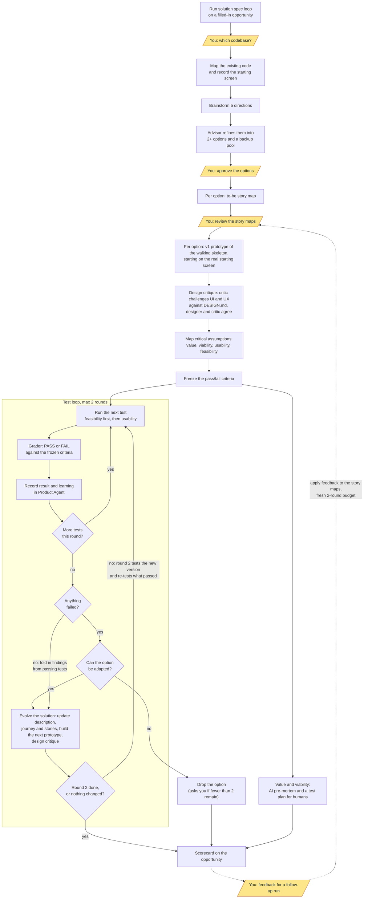

# Product Builder Agent

An open-source agentic product builder that helps you structure your product thinking using Teresa Torres's Opportunity Solution Tree framework — powered by AI skills that understand your full context.

Built with Next.js 16, React 19, and Zustand. Runs entirely on your machine. Your data stays local.

## What It Does

- **Discovery Tree Dashboard** — manage your product thinking from business outcomes down to assumptions and tests in a single interactive tree
- **AI Actions** — context-aware AI skill invocations at every entity level. One click copies a prompt, paste it into your AI agent, and the AI works with your full product context
- **Metric Tracking** — track outcome metrics with time-series data, targets, runway dates, and trend indicators
- **Personas** — define and assign user personas to opportunities and product outcomes
- **WIP Briefing** — AI reads your entire discovery tree and generates a structured health report per product outcome: metric health, management signals, critical proposals, shipped solution impact analysis
- **Solutions Brainstorming** — AI researches your opportunity and generates 5 distinct solution approaches using first-principles thinking
- **Assumption Testing** — AI surfaces critical assumptions behind your solutions and designs lightweight tests
- **Story Map** — AI slices solutions into INVEST-compliant user stories organised in a Jeff Patton-style story map, with walking skeleton, enhancement, and GA iterations. Each story gets Gherkin acceptance criteria and analytics events written directly into it
- **Planning Prompts** — generate rich implementation prompts for your AI agent that include opportunity context, solution details, persona, and codebase path

## Prerequisites

Before you start, make sure you have the following installed on your machine:

### 1. Node.js (v20 or later)

Download and install from [nodejs.org](https://nodejs.org/).

After installing, verify it works by opening a terminal and running:

```bash
node --version
# Should show v20.x.x or higher

npm --version
# Should show 10.x.x or higher (comes bundled with Node.js)
```

### 2. Git

Download and install from [git-scm.com](https://git-scm.com/).

Verify:

```bash
git --version
```

### 3. AI agent (optional, for the AI workflow)

Product Agent works with two AI coding tools. Both are optional — you can use the app without them — but you need one to run the AI skills workflow.

- **Claude Code** — install from [docs.anthropic.com](https://docs.anthropic.com/en/docs/claude-code). See [SETUP.md](./SETUP.md) for setup.
- **GitHub Copilot in VS Code** — requires VS Code 1.99+ with the GitHub Copilot extension. See [SETUP-COPILOT.md](./SETUP-COPILOT.md) for setup.

### 4. Playwright Chromium (optional, for the solution spec loop)

The solution spec loop tests prototypes in a headless Chromium browser. The loop installs its helper on first run, but the browser download is about 150 MB, so you may prefer to do it ahead of time:

```bash
cd ProductSkills/solution-spec-loop/scripts
npm install
npx playwright install chromium
```

## Getting Started

### Step 1: Clone the repository

```bash
git clone https://github.com/catalinviciu/product-builder-agent.git
cd product-builder-agent
```

### Step 2: Install and run

```bash
cd Product-Agent-app
npm install
npm run dev
```

You should see output like:

```
▲ Next.js 16.1.6 (Turbopack)
- Local: http://localhost:3000
```

### Step 3: Build the MCP server

```bash
cd mcp-server
npm ci
npm run build
```

> **Note:** You only need to do this once. Claude Code will start the MCP server automatically when you run it in this folder. If you're using VS Code / GitHub Copilot, the server starts automatically when you open Copilot Chat in Agent mode.

### Step 4: Open in your browser

Go to [http://localhost:3000](http://localhost:3000)

You'll see the discovery tree dashboard with sample data (FreshCart Grocery) pre-loaded.

## Available Commands

Run these from the `Product-Agent-app/` folder:

| Command | What it does |
|---------|-------------|
| `npm run dev` | Start the dev server (auto-reloads on code changes) |
| `npm run build` | Create a production build (use to verify everything compiles) |
| `npm start` | Serve the production build (run `npm run build` first) |
| `npm run lint` | Run the linter to check for code issues |

Run these from the `mcp-server/` folder:

| Command | What it does |
|---------|-------------|
| `npm ci && npm run build` | Build the MCP server (run once, or after `src/` changes) |

## How It Works

- **All data is stored locally** in `Product-Agent-app/data/store.json` (auto-generated on first use)
- The app runs entirely on your machine — no external database or cloud services needed
- Changes you make in the UI are automatically saved to the local JSON file
- The **MCP server** (`mcp-server/`) is a local bridge between your AI agent and the app — skills read and write through it instead of accessing `data/store.json` directly

## Using Product Agent with Your Codebase

Product Agent is designed to sit alongside your application code and help you plan features using AI agents like Claude Code or GitHub Copilot. Here's the full workflow, step by step.

### 1. Set up your workspace folder

Place your codebase in the same parent folder as Product Agent:

```
your-workspace/
├── Product-Agent-app/      # This app
├── ProductSkills/          # Agent skills (AI capabilities)
├── mcp-server/             # MCP server (bridge between AI agent and app)
├── your-app/               # Your application code
└── CLAUDE.md / .github/    # Agent context (created during setup)
```

If you don't have a codebase yet, just create an empty folder — you can start building your product thinking first and add code later.

### 2. Teach your AI agent about your setup

Open your AI agent in the workspace root folder (the parent that contains both `Product-Agent-app/` and your codebase). Then follow the setup guide for your tool:

- **Claude Code** — follow **[SETUP.md](./SETUP.md)**
- **GitHub Copilot / VS Code** — follow **[SETUP-COPILOT.md](./SETUP-COPILOT.md)**

These guides will help you:

- Create a project context file that teaches your AI agent about both Product Agent and your codebase
- Set up the ProductSkills
- Bootstrap a User Story Map for your project (skip this if your codebase is empty)
- Set the code path in Product Agent's UI

### 3. Define your product thinking

In the Product Agent UI:

1. **Create a Product Line** — give it a name. This is the top-level container for your product.
2. **Set the code path** — edit the product line and fill in your codebase folder name (e.g. `your-app/`). If you don't have a codebase yet, leave it blank for now.
3. **Use your AI co-worker to set up the structure** — in the empty product line, click the **AI Actions** button and select **Set up product line with co-worker**. A prompt is copied to your clipboard — paste it into your AI agent (Claude Code or GitHub Copilot). Your AI co-worker will interview you in plain language and create the initial Business Outcome, Product Outcome, and first Opportunities for you. You don't need to know any product management terminology.

   > **Don't fill in the tree manually.** Product Agent is built around the co-worker model: your AI agent does the thinking and writing, the app shows you what you built together. The manual fields exist for edits — not for first entry.

4. **Define Personas** — add the user/buyer personas for your product line (you can do this during or after the co-worker interview).
5. **Continue building the tree with AI Actions** — at every level (Opportunity, Solution, Assumption), use the AI Actions menu to write, brainstorm, and test with your co-worker rather than typing manually.

### 4. Use AI Actions

Every entity in the tree has an **AI Actions** dropdown menu with context-aware actions. Click an action, and a prompt is copied to your clipboard — paste it into your AI agent (Claude Code or GitHub Copilot).

**At the product line level:**
- **Copy AI context anchor** — reference the product line in any AI conversation
- **Product line WIP briefing** — AI generates a full health report per product outcome

**At the entity level (varies by level):**
- **Write/update opportunity** — AI writes a structured opportunity from your input (product outcome and opportunity levels)
- **Brainstorm solutions** — AI researches the problem and proposes 5 distinct approaches (opportunity level)
- **Run solution spec loop** — AI specs at least 2 solution options and tests their usability and feasibility assumptions on prototypes, in up to 2 rounds. Needs a filled-in opportunity and a product outcome with a metric (opportunity level)
- **Test assumptions** — AI surfaces critical assumptions and designs tests (solution level)
- **Build prototype** — AI builds a working prototype from your solution context
- **Plan implementation** — AI generates a full implementation plan with codebase context (solution level)

### 5. Iterate

As you ship features and learn, come back to Product Agent to:

- Update entity status (draft → explore → commit → done)
- Track outcome metrics over time
- Run a WIP Briefing to see the health of your product line at a glance
- Add Assumptions and Tests to validate your decisions
- Refine Opportunities based on what you've learned
- Start the next Solution's planning prompt

## Product Skills

The `ProductSkills/` folder contains AI agent skills — behavioral instructions that extend what Claude Code (or other AI agents) can do when working with your product context:

| Skill | What it does |
|-------|-------------|
| **new-product-line-setup** | Interviews you in plain language and creates the initial Business Outcome, Product Outcome, and first Opportunities — no PM terminology required |
| **opportunity-writer** | Writes structured opportunities from unstructured input, keeping content strictly in problem space |
| **solutions-brainstormer** | Researches an opportunity and generates 5 distinct solution approaches using first-principles thinking |
| **solution-spec-loop** | Runs an opportunity end to end: maps the existing code, refines 5 directions into at least 2 options, then tests their usability and feasibility assumptions in up to 2 prototype rounds |
| **assumption-tester** | Surfaces critical assumptions behind solutions and designs lightweight validation tests |
| **prototype-builder** | Builds working prototypes from solution context |
| **wip-briefing** | Reads your full discovery tree and generates a WIP health report per active product outcome |
| **story-map-updater** | Keeps a Jeff Patton-style User Story Map in sync as features are planned and shipped |
| **user-story-slicer** | Slices a user journey or system process into INVEST-compliant story cards |
| **user-story-ac-writer** | Writes Gherkin acceptance criteria and analytics events per story |
| **vocabulary-miner** | Mines emotional vocabulary from online communities for audience research |
| **code-to-story-map-archeologist** | Reverse-engineers a Jeff Patton style story map from an existing codebase, for one workflow between a start and an end point |
| **codebase-detector** | Scans your codebase and detects the design system and analytics platform, then saves them to the product line settings |
| **interview-evidence-opportunity-documentation** | Routes evidence from an interview snapshot onto the opportunities under a product outcome, for and against |
| **pm-context** | Explains the Opportunity Solution Tree and the rules for staying in problem space vs. solution space |
| **writing** | Writes clear, concise prose free of AI tells; the other skills load it before writing anything |

These skills are invoked through the AI Actions menu in the UI — you don't need to reference them manually.

## Solution Spec Loop

Run **Run solution spec loop** from an opportunity's AI Actions menu and paste the prompt into an AI agent that can run subagents with a choice of model per subagent, such as Claude Code or Kiro. Paste it outside plan mode: it stops only at its review points and runs the rest on its own. The AI takes the opportunity from 5 brainstormed directions to at least 2 tested solution options, and records every goal, result and learning in the discovery tree. It works like Karpathy's [autoresearch](https://github.com/karpathy/autoresearch): pass/fail criteria are frozen before a test runs, tests run one at a time, and a change to a solution only stays if the tests it already passed still pass.

The diagram shows:

- **Before the loop:** map the existing code and record the screen the workflow starts on, brainstorm 5 directions, the advisor refines them into at least 2 options plus a backup pool, then a story map per option.
- **Where it waits for you (in yellow):** choosing the codebase, approving the options, and reviewing the story maps before any prototype is built.
- **Prototypes:** v1 of each option starts on the real starting screen from the codebase, rebuilt from its source files. No agent picks its own starting screen.
- **Design critique:** every prototype version, before it's tested, goes to a separate design critic who challenges the UI and UX against the design system's DESIGN.md. The designer answers each finding, the two agree on changes, and the designer applies them. If the DESIGN.md can't be found, the loop asks you where it is.
- **The test loop, capped at 2 rounds:** one test at a time, grade, record. After every round, the solution evolves: failures are adapted around, findings from passing tests are folded in, the whole spec (description, journey, stories) is updated, and the next prototype version is built, so round 2 tests the evolved solution. Round 2 also re-tests what passed in round 1, and a change that breaks one of those is undone in the spec and the prototype together.
- **Dropping an option:** only when it can't be adapted. The loop asks you if fewer than 2 options remain.
- **Value and viability:** go to an AI pre-mortem and a test plan for humans.
- **The end:** a scorecard on the opportunity. Tests, assumptions and options show as links you can click, never as IDs.
- **Follow-up runs:** give feedback, edit the story maps if you like, and run the action again. The next run starts from your feedback and everything learned so far, with a fresh 2-round budget.



The yellow steps are the only places the loop waits for you. Everything else runs on its own, and the scorecard lists what humans still need to test with real customers. Details: [`ProductSkills/solution-spec-loop/SKILL.md`](../ProductSkills/solution-spec-loop/SKILL.md).

## Stopping the Server

Press `Ctrl + C` in the terminal where the server is running.
